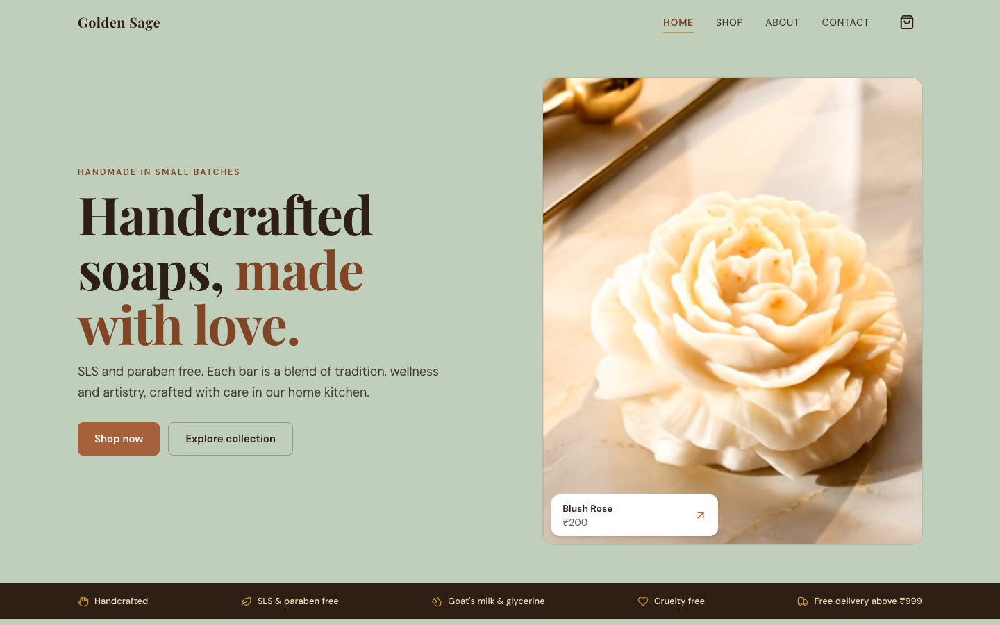
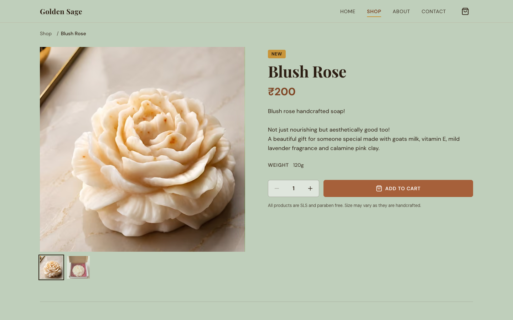
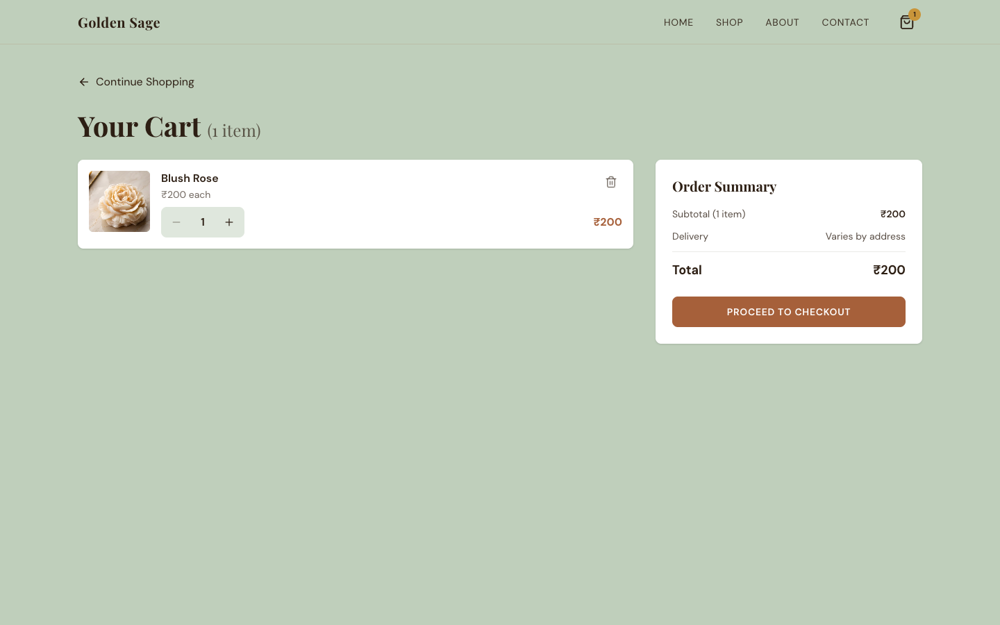
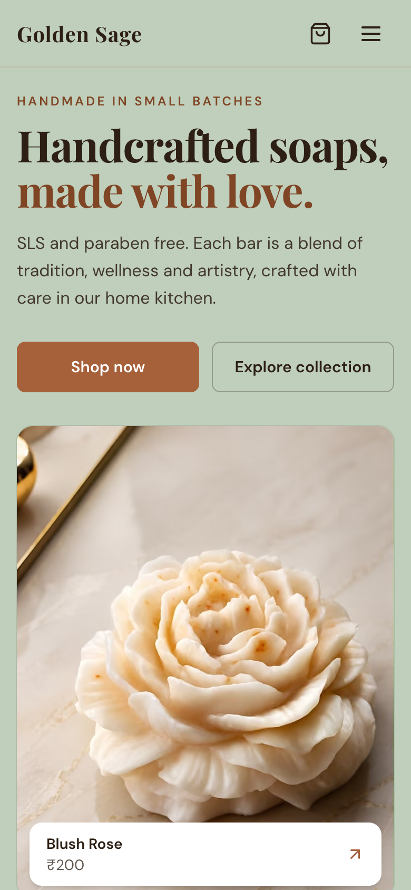
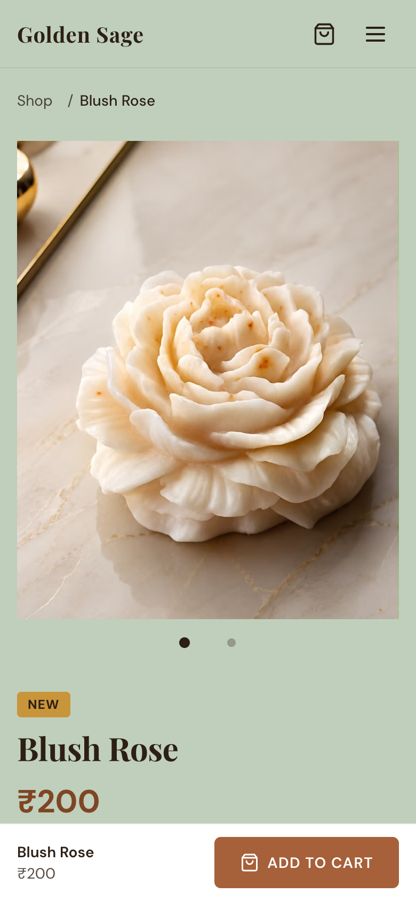
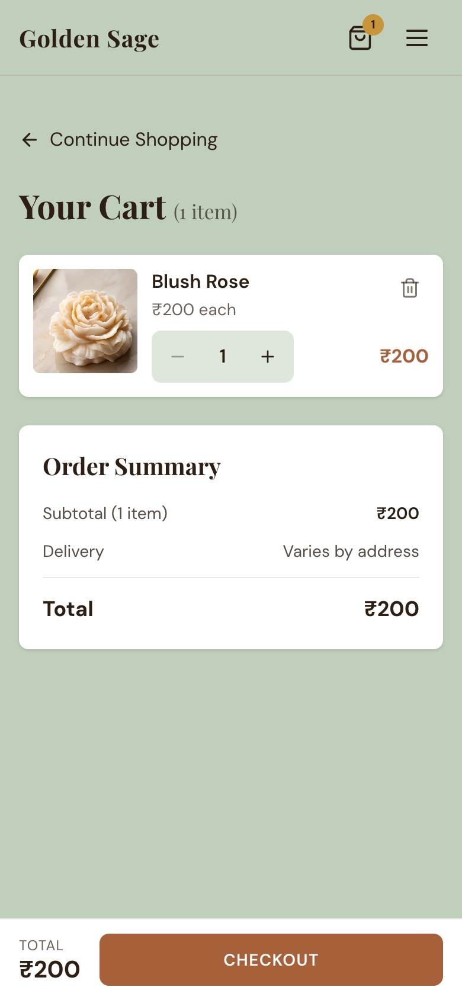

# Golden Sage

Live site: **https://golden-sage-nine.vercel.app**

## About

Golden Sage is an online store for handmade organic soap and skincare. Every bar is made in small batches with natural ingredients such as goat's milk, glycerine and essential oils, and is SLS and paraben free. Customers browse the collection, add products to a cart and place an order.

This repository is a showcase of the storefront. The source code is private.

## Tech stack

- Next.js 15
- React 19
- TypeScript
- Tailwind CSS 4
- Supabase
- Vercel

## Screenshots

### Desktop (1440 px wide)

| Home | Product | Cart |
|---|---|---|
|  |  |  |

### Mobile (390 px wide)

| Home | Product | Cart |
|---|---|---|
|  |  |  |

## License

MIT, see [LICENSE](LICENSE). The license covers the text of this repository; product names, photos and the Golden Sage brand belong to their owner.
